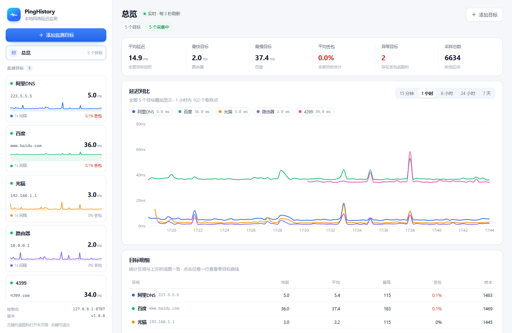

# PingHistory · 本地网络延迟监测

一个用 **Go + React** 编写的单机网络延迟（ping）监测工具：Web 控制台操作、SQLite 落库、系统托盘常驻。
双击运行后自动打开浏览器控制台，随后驻留系统托盘；左键点托盘图标回到控制台，右键菜单可退出。



## 功能

- **多目标监测**：任意数量域名 / IP，各自独立的探测间隔（1–3600 秒）。
- **总览对比**：一个视图内把所有目标叠加到同一张折线图，每个目标固定一种颜色，
  图例可点选隐藏/恢复某条曲线；下方目标明细表汇总当前、平均、最高、丢包与样本数。
- **实时折线图**：单目标视图展示平均延迟 / 区间峰值 / 丢包标记，支持 15 分钟、1 小时、6 小时、24 小时、7 天五档区间。
- **丢包可视化**：曲线上的红点标出发生丢包的时刻，图下方的「丢包」条带按时间桶铺满宽度、颜色越深丢包率越高；
  整桶全丢时曲线在该处断开、条带为满格深红。悬浮提示给出精确的丢包率与丢包次数。
- **本地持久化**：全部探测写入 SQLite（`data/pinghistory.db`），按日自动清理（默认保留 7 天）。
- **指标概览**：当前、平均、最低、最高、丢包率、样本数，以及最近原始探测记录。
- **目标管理**：新增、编辑、暂停/继续、删除（删除会一并清理历史数据）。
  编辑可修改主机地址、显示名称、探测间隔与数据大小（`ping -l` 字节数，1–65000，默认 32）；
  保存后该目标立即按新参数重新探测，历史记录保留。
- **重置统计**：总览右上角「重置统计」可选择一个时间点（1 / 7 / 30 天前，或全部），
  只删除该时间点之前的探测记录；选「全部」时会顺带重启采集，让所有目标从同一时刻重新开始。
  同一弹窗内还可设置「自动保留时间」（1 / 3 / 7 天或永久），**选择即生效**并写入 `config.json`。
- **系统托盘**：左键单击打开控制台；右键菜单为「打开控制台 / 打开数据目录 / 退出」。
- **单实例**：重复启动时不再创建第二个进程，而是直接唤起已运行实例的控制台。

## 快速开始

```powershell
# 首次构建（前端 + Windows x64 + Linux ARMv8）
pwsh -File .\build.ps1

# 只要其中一个平台
pwsh -File .\build.ps1 -Target windows
pwsh -File .\build.ps1 -Target linux-arm64

# 运行
.\dist\PingHistory.exe
```

启动后：

1. 浏览器自动打开 `http://127.0.0.1:8787`；
2. 托盘区出现圆形波形图标；
3. 在控制台点击「添加监测目标」，填入 `223.5.5.5`、`www.baidu.com` 等即可开始采样；
4. 添加多个目标后，左侧「总览」会把所有目标的曲线叠加到同一张图里，按颜色区分对比。

> 无需管理员权限：探测通过系统 `ping` 命令完成，普通用户即可运行。

## 端口与配置

首次运行会在可执行文件同级生成 `data/config.json`：

```json
{
  "port": 8787,
  "listen": "0.0.0.0",
  "open_browser": true,
  "retention_days": 7
}
```

- `port`：Web 控制台端口，默认 `8787`；若被占用会自动顺延，并写回配置文件。
- `listen`：监听地址。默认 `0.0.0.0`，同网段的手机/电脑可直接访问 `http://<本机IP>:8787`；
  只想本机访问时改为 `127.0.0.1`。控制台**没有鉴权**，请注意所在网络环境。
- `open_browser`：启动时是否自动打开浏览器（非 Windows 默认 `false`）。
- `retention_days`：探测记录保留天数，`0` 表示永久保留；界面上可随时修改并立即生效。

命令行参数可临时覆盖：

| 参数 | 说明 |
| --- | --- |
| `-port 9000` | 覆盖配置文件端口 |
| `-listen 0.0.0.0` | 覆盖监听地址 |
| `-data D:\pingdata` | 指定数据目录（默认 exe 同级 `data`） |
| `-no-browser` | 启动时不打开浏览器 |
| `-no-tray` | 不创建托盘（非 Windows 默认开启） |

## 数据存储

```
data/
├── config.json        # 运行配置
├── pinghistory.db     # SQLite（targets / probes）
├── app.ico            # 托盘图标（自动释放）
└── logs/app.log       # 运行日志
```

表结构：

- `targets(id, name, host, interval_sec, enabled, created_at)`
- `probes(id, target_id, ts, rtt_ms, ok)` —— `rtt_ms` 为 NULL 表示本次超时

图表接口按时间桶聚合（`AVG` / `MAX` / 丢包计数），因此长时间区间也能保持稳定的响应体积。

## HTTP 接口

| 方法 | 路径 | 说明 |
| --- | --- | --- |
| GET | `/api/health` | 服务状态、端口、版本、总样本数 |
| GET | `/api/overview?range=3600&points=240` | 目标列表 + 统计 + 聚合曲线（前端主轮询） |
| GET | `/api/targets` | 目标列表 |
| POST | `/api/targets` | 新建目标 `{name, host, interval_sec}` |
| PATCH | `/api/targets/{id}` | 改名 / 改主机 / 改间隔 / 改数据大小 / 暂停恢复 |
| DELETE | `/api/targets/{id}` | 删除目标及历史 |
| GET | `/api/targets/{id}/series` | 单目标曲线与统计 |
| GET | `/api/targets/{id}/probes?limit=30` | 最近原始探测记录 |
| POST | `/api/reset` | 按范围删除历史：`{"before_days":7}`，`0` 表示全部并重启采集 |
| PATCH | `/api/settings` | 更新运行设置：`{"retention_days":3}`，`0` 表示永久保留 |

服务默认监听 `0.0.0.0:8787`（所有网卡）。如需仅本机访问，把 `config.json` 的 `listen` 改为 `127.0.0.1`。

## 目录结构

```
.
├── main.go                   # 启动流程：配置 → 数据库 → 探测 → HTTP → 托盘
├── internal/
│   ├── api/                  # REST 接口 + 单页应用托管
│   ├── config/               # config.json 读写
│   ├── osutil/               # 打开浏览器 / 目录
│   ├── pinger/               # 每目标独立协程调度 + ping 输出解析
│   ├── store/                # SQLite 访问（modernc.org/sqlite，纯 Go 无 CGO）
│   └── tray/                 # Win32 Shell_NotifyIcon 托盘
├── web/                      # React + Vite + Recharts 控制台
│   ├── src/
│   └── dist/                 # 构建产物，被 go:embed 内嵌
├── tools/genicon/            # 生成 assets/app.ico 的小工具
├── assets/app.ico            # 应用与托盘图标
└── build.ps1                 # 一键构建
```

## 前端开发

后端已在 8787 运行时：

```powershell
cd web
npm install
npm run dev        # http://127.0.0.1:5173，/api 自动代理到 8787
```

修改前端后执行 `npm run build`，再重新 `go build` 即可把新界面内嵌进可执行文件。

## 部署到 OpenWrt（低功耗设备）

### 1. 交叉编译

```powershell
pwsh -File .\build.ps1                       # 默认同时构建 Windows x64 + Linux ARMv8
pwsh -File .\build.ps1 -Target linux-arm64   # 只要 ARMv8 产物
```

所有产物都在 `dist/`：`dist/PingHistory.exe`（10.8MB）、`dist/PingHistory-linux-arm64`（约 **9.9MB**）。
纯静态链接、无 CGO，不依赖路由器上的任何运行库。数据目录仍然落在 `dist/` 的上一级（即项目根 `data/`），
从 `dist\PingHistory.exe` 启动不会另起一份空白数据。

> **MIPS 设备（mt7621 等）暂不支持**：`modernc.org/sqlite` 没有 32 位 MIPS 实现，交叉编译会直接失败。
> 若要覆盖这类设备需替换存储引擎。

### 2. 安装为系统服务

```sh
scp dist/PingHistory-linux-arm64 root@192.168.1.1:/usr/bin/pinghistory
scp deploy/openwrt/pinghistory.init root@192.168.1.1:/etc/init.d/pinghistory
ssh root@192.168.1.1 'chmod +x /usr/bin/pinghistory /etc/init.d/pinghistory
  /etc/init.d/pinghistory enable
  /etc/init.d/pinghistory start'
```

服务脚本以 `-data /etc/pinghistory -no-tray -no-browser -listen 0.0.0.0` 启动，
之后浏览器访问 `http://<路由器IP>:8787` 即可。数据目录 `deploy/openwrt/config.sample.json`
给出了一份路由友好的配置（保留 3 天、关闭浏览器、监听 0.0.0.0）。

### 3. 存储预算（实测每条样本 ≈ 60 字节）

| 目标数 | 间隔 | 每天行数 | 每天占用 | 3 天 | 7 天 |
| --- | --- | --- | --- | --- | --- |
| 5 | 1s | 432,000 | 25.9 MB | 78 MB | 181 MB |
| 5 | 5s | 86,400 | 5.2 MB | 16 MB | 36 MB |
| 5 | 10s | 43,200 | 2.6 MB | 8 MB | 18 MB |
| 3 | 10s | 25,920 | 1.6 MB | 5 MB | 11 MB |

闪存 128MB 以内的设备建议「5–10 秒间隔 + `retention_days: 3`」。探测间隔是存储与 CPU 的第一杠杆。

### 4. 已做的资源优化

- **WAL 上限 1MB**：`wal_autocheckpoint=256` + `journal_size_limit=1MB`，实测数据目录由 4.9MB 降至 1.9MB。
- **页缓存 1MB**、临时表放内存，避免把闪存当临时盘写。
- **保留期清理**改为每 10 分钟一批删 2000 行，避免一次删除几十万行造成长时间写锁。
- **概览接口按区间缓存**：15 分钟档 2 秒、1 小时档 6 秒、24 小时档 12 秒、7 天档 20 秒；
  前端轮询不再每次都做全量聚合。
- **长区间省掉峰值定位查询**：7 天档原本每个目标要多做一次全表排序，现改为从聚合序列反推峰值桶。
- **探测并发按平台区分**：Linux / 路由器限制 5 个并发 `ping`，Windows x64 不限制
  （桌面算力充足，限流反而会让同刻到点的目标排队、采样时间偏移）。启动日志会打印当前策略。
- **日志 2MB 轮转**、托盘图标仅在 Windows 释放到数据目录。
- **非 Windows 默认关闭托盘与浏览器**（路由没有桌面环境）。

### 5. 注意事项

- `ping` 需要 root 或 `CAP_NET_RAW`；procd 默认以 root 运行，无需额外配置。
- 控制台**没有鉴权**，服务默认监听 `0.0.0.0`（所有网卡）。若设备处于不可信网络，请把 `listen` 改为 `127.0.0.1`
  或用防火墙限制 8787 端口的来源。
- 主要 CPU 开销来自「每条样本拉起一个 ping 进程」。若需要 1 秒级高频探测，建议减少目标数量，
  或在后续版本改为常驻 `ping` 进程流式解析（可消除进程启动开销）。

## 技术说明

- **SQLite 驱动**：`modernc.org/sqlite`（纯 Go 实现），无需 CGO / GCC，Windows 上开箱即用。
- **延迟采集**：调用系统 `ping`（隐藏窗口、单次 1 包、超时 1.6s），解析中英文输出中的 `时间/ time=<n>ms`；
  `<1ms` 记作 0.5ms。不依赖原始套接字，因此无需管理员权限。
- **托盘**：直接调用 `user32` / `shell32`，`WM_LBUTTONUP` 打开控制台，`WM_RBUTTONUP` 弹出菜单，
  因此能做到「左键直接开网页、右键才出菜单」。
- **图表**：Recharts。Y 轴以「典型延迟」（时间桶均值的中位数）为基准，典型值的 1.5 倍内正常显示、
  尖峰最多放大到 3 倍；更高的尖峰不压缩整条曲线，而是在图例处标注「峰值 xxx ms 超出纵轴」。
  「最高」指标会同时给出该峰值的出现时刻，便于定位。
- **数据大小**：`-l` 参数透传给系统 `ping`（Windows `-l`、Linux `-s`），可用于观察分片/MTU 对时延的影响。
  修改后采集协程会重启并立即探测一次。
- **总览配色**：`web/src/palette.js` 按目标顺序稳定分配 10 色，侧边栏迷你曲线、图例与折线保持一致；
  各目标曲线按同一时间桶对齐后叠加。
- **多目标叠加的时间栅格**：`/api/overview` 在同一次请求内固定 `until`，用 `(until - since) / points`
  算出唯一的桶宽。若各目标各自取 `time.Now()`，串行查询一旦跨越整数边界就会让桶宽相差 1ms，
  各目标时间栅格错开，叠加后每行只命中一个目标，折线会被打散成孤立点。
  缺失的时间桶由前端 `fillSeriesGaps` 补空行断开，避免折线跨越停机区间连成直线。
- **为什么丢包不能只画在折线上**：折线是每个时间桶的**平均**延迟，桶内丢包只是"没参与平均"的样本，
  平均值不会因此断裂——只有整桶全部超时才产生 `null` 断点。因此单目标视图额外用「红点 + 底部条带」两个层次表达丢包：
  红点定位时刻，条带用颜色深浅表达丢包率，两者都与折线共享同一条时间轴。
- **短链接口复用**：总览与单目标视图共用 `/api/overview` 一次请求，避免多目标时产生 N 个并发请求。
